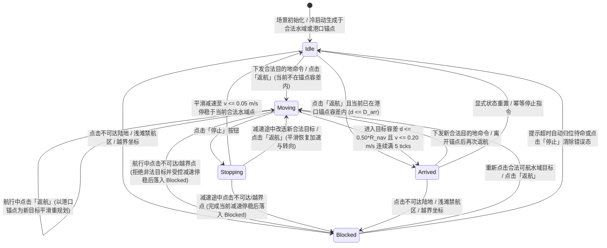

# S1 行为、状态机、路线样本口径与异常规格书

## 1. 文档定位、版本元数据与适用对象

本规格书为 `S1-T01`（需求与验收冻结）核心交付物之一，定义第一阶段海岛世界与舰船航行的**可观测行为、单一航行状态机、可操作玩家旅程、到达/停止/改目标/返航/不可达规则、相机与 HUD 交互契约、20 次场景重入恢复口径，以及 100 条合法路线与不可达负例样本标准**。

- **文档标识与规格版本**：`S1-BEHAVIOR-SPEC-v1.2` / 规格版本 `v1.2.0`（对应候选 `S1-T01-CANDIDATE-v1.2-20261106`，返工单 `SHIP-10` / `01a1b071-19d9-7717-8d32-c00f2350ac5f`，幂等键 `T01-REWORK-1`，第 `1` 轮业务返工；制作者 `A01` `df0859d2-a436-4389-9c83-da8890471e97`，当前 Run `01a1b071-1d70-741a-9f14-2d64d5530ea8`；独立验收者 `A02` `1e385681-ce16-4e44-9db3-c82ea8dcd2e4`）。
- **适用下游任务**：`S1-T02`（架构与接口契约）、`S1-T04`（测试设计）、`S1-T05`（视觉样板规范）、`S1-T08/T09/T14`（世界与尾迹）、`S1-T10/T13`（镜头、输入与 HUD）、`S1-T11/T12`（舰船运动、状态机与寻路命令）、`S1-T15`（集成）、`S1-T16/T18/T19/T20/T22`（自动化脚本、独立实测与阶段终验）。
- **图 4 绑定与来源归属边界**：绑定 Owner 提供的 `references/style/figure04_ocean.png`（`1006×303 px`，SHA256 `47778e452a519f6482abfee15cdab3e202a3475f3186fac99c507693eb4cb0b2`；Owner 报告原始 JPEG SHA256 `2ae118b72245e88b6b8eaee719b46061029adebe6b90a9e424e21f84804d320a`）。**来源区分声明**：该 PNG 仅支持定性视觉观察（如右图倾斜俯视构图、四层水深过渡、岸线泡沫、圆润岛屿、单船 3D 体积与弯曲白尾迹），图像本身无角度标注与几何比例尺；`55.0° ± 2.0°` 俯角明确来自 Owner 方向及冻结 `S1-AC02` 起测目标（非图像测量），`85.0 m` 默认相机高度与常规水道 `4～8` 倍船宽明确来自 `A01` 在 `S1-T01` 给出的工程设计建议初值（非从图读得）。
- **数值属性声明**：本文件中全部数值均为 `S1-T01` 冻结设计目标或建议起测初值（`numbers_are_targets_not_results = true`），非已实测结果。

---

## 2. 单一航行状态机规格（Single Navigation State Machine）

### 2.1 状态枚举定义（`ShipNavigationState`）

依据 `S1-T11` 目标（“单一航行状态源，速度/转向连续且有上限；`Idle/Moving/Stopping/Arrived/Blocked` 状态可读；视觉起伏不改变导航坐标”），主船在任意时刻有且仅有一个权威导航状态：

| 状态枚举值 | 中文名称 | 核心运动学与业务语义 | HUD 状态显示文本建议 |
| --- | --- | --- | --- |
| `Idle` | 待命 / 静止 | 主船位于合法可航水域内，无活动航行路径或已完成主动停止减速；水平线速度 $v = 0.0\text{ m/s}$（静止阈值 $v \le 0.05\text{ m/s}$ 后归零），角速度 $\omega = 0.0^\circ\text{/s}$。 | `待命 (Idle)` |
| `Moving` | 航行中 | 主船持有合法的绕岛路径点序列 $(P_1, P_2, \dots, P_n)$ 及最终目标点 $P_{\text{target}}$，正沿路径推进；速度 $v \in (0, v_{\max}]$ 与转向角速度 $\omega \in [-\omega_{\max}, +\omega_{\max}]$ 连续变化。 | `航行中 (Moving)` |
| `Stopping` | 减速停止中 | 玩家在 `Moving` 状态主动下发「停止」命令（或因异常保护触发受控驻停），主船清除后续远端路径点，沿当前合法水域前向切线以受控减速度 $a_{\text{stop}}$ 平滑减速至停稳（$v \le 0.05\text{ m/s}$），随后自动转入 `Idle`。 | `停止中 (Stopping)` |
| `Arrived` | 已抵达 | 主船导航代理中心进入当前目标点（普通水域目标点或港口合法停泊锚点）的到达容差半径 $D_{\text{arr}} = 0.50 \times R_{\text{nav}}$ 内，且满足速度阈值 $v \le 0.20\text{ m/s}$ **连续停留满 $N_{\text{arrive}} = 5\text{ ticks}$**；触发唯一一次 `OnArrived` 事件后保持静止。 | `已到达 (Arrived)`（若为港口锚点可附注 `已返航停泊`） |
| `Blocked` | 不可达 / 受阻 | 玩家请求的目标点位于陆地内部、岛屿障碍、船体净空不足的浅滩/死水区或 `2048×2048 m` 世界边界外，路径规划器判定目标非法或无合法净空路径；拒绝生成穿岛/越界路径，主船可读状态置为 `Blocked` 并附带明确原因码（`BlockedReason`），HUD 显示不可达提示。 | `不可达 (Blocked)` |

### 2.2 状态机结构图

### 2.3 状态转换完备矩阵

| 转换编号 | 当前状态 | 触发输入 / 事件 | 判定条件 | 下一状态 | 运动学与可观测副作用（日志 / 事件 / HUD） |
| --- | --- | --- | --- | --- | --- |
| `TR-01` | `Idle` / `Arrived` / `Blocked` | 点选水域目标 $P_{\text{target}}$ | $P_{\text{target}}$ 位于世界边界内合法水域，且存在满足船体导航半径 $R_{\text{nav}}$ 净空的路径，且 $d(P_{\text{ship}}, P_{\text{target}}) > D_{\text{arr}}$ | `Moving` | 生成路径点序列；速度从 $0$ 按 $a_{\text{acc}}$ 连续加速；触发 `OnCommandAccepted(MoveTo)` 与 `OnStateChanged(* -> Moving)`；HUD 更新目标与剩余距离。 |
| `TR-02` | `Idle` / `Arrived` / `Blocked` | 点选水域目标 $P_{\text{target}}$ 或点击「返航」 | 目标合法，但主船当前已在目标容差内（$d \le D_{\text{arr}}$ 且 $v \le 0.20\text{ m/s}$） | `Arrived` | 不产生多余抖动位移；直接确认 `Arrived`（若此前非 `Arrived` 则触发 1 次 `OnArrived`），HUD 显示已到达/已在港口锚点。 |
| `TR-03` | `Idle` / `Arrived` / `Blocked` | 点选非法目标 $P_{\text{invalid}}$ | $P_{\text{invalid}}$ 落在陆地障碍、浅滩净空不足区、封闭死水区或 `2048×2048 m` 世界边界外 | `Blocked` | **船体坐标严禁发生任何位移**（$\Delta X = 0, \Delta Z = 0$）；状态置为 `Blocked`；输出原因码 `BlockedReason`；触发 `OnCommandRejected`；HUD 显示不可达/越界错误提示。 |
| `TR-04` | `Moving` | 持续沿路径航行 | 进入终点容差 $d(P_{\text{ship}}, P_{\text{target}}) \le 0.50 \times R_{\text{nav}}$ 且 $v \le 0.20\text{ m/s}$ **连续保持满 $5\text{ ticks}$** | `Arrived` | 接近终点时按减速距离提前平滑减速；满 5 ticks 后速度归零，状态切换为 `Arrived`，**仅触发 1 次** `OnArrived` 事件；HUD 剩余距离归零（或显示 `≤ D_arr`）。 |
| `TR-05` | `Moving` | 点击 HUD「停止」 | 主船处于航行运动中（$v > 0.05\text{ m/s}$） | `Stopping` | 立即废弃未走完的后续路径点；沿当前合法航向切线（带前方障碍安全检测）以 $a_{\text{stop}}$ 平滑减速；触发 `OnStopRequested` 与 `OnStateChanged(Moving -> Stopping)`。 |
| `TR-06` | `Stopping` | 减速过程更新 | 水平线速度降至 $v \le 0.05\text{ m/s}$ | `Idle` | 速度精确置为 $0.0\text{ m/s}$，停留于当前合法水域坐标 $(X_{\text{stop}}, Z_{\text{stop}})$；触发 `OnStopped` 与 `OnStateChanged(Stopping -> Idle)`；尾迹停止新生成并按世界轨迹自然衰减。 |
| `TR-07` | `Moving` / `Stopping` | 点选新合法目标 $P_{\text{new}}$ 或点击「返航」 | $P_{\text{new}}$（或港口锚点 $P_{\text{anchor}}$）在可航水域内且存在合法净空路径 | `Moving` | **不瞬移、不强制先原地急停**：以当前坐标 $(X, Z)$、当前速度矢量 $\vec{v}$ 与当前航向角 $\theta$ 为起点重规划路径，按角速度上限 $\omega_{\max}$ 与加速度上限 $a_{\text{acc}} / a_{\text{stop}}$ 连续平滑转向新路径；替换旧目标。 |
| `TR-08` | `Moving` / `Stopping` | 点选非法目标 $P_{\text{invalid}}$ | $P_{\text{invalid}}$ 为陆地、净空不足、死水或越界点 | `Blocked`（经受控停船或即时拒绝） | 拒绝非法目标，触发 `OnCommandRejected(BlockedReason)` 与 HUD 不可达提示；严禁生成穿岛路径，取消原远端路径并按受控减速度 $a_{\text{stop}}$ 在合法水域停稳后状态固定为 `Blocked`（保证 `Blocked` 状态始终可读可测且船体安全）。 |
| `TR-09` | `Moving` | 重复点选同一目标点 | 新点选目标与当前活动目标距离 $\Delta d_{\text{target}} \le 0.25 \times R_{\text{nav}}$ | `Moving` | **幂等保持当前航行**：不清空重算导致船体顿挫，**绝不额外生成/克隆主船实例**（`ActivePlayerShipCount == 1`），不重复绑定事件监听器。 |

---

## 3. 核心可操作旅程详细行为规格（Operable Player Journeys）

### 3.1 旅程 J01：选船（Ship Selection）

1. **前置条件**：场景已加载完毕，世界中存在 1 艘可操作主船（处于港口合法停泊锚点或指定初始合法水域点，状态 `Idle`），3 种真实 3D 船型资产均已就绪。
2. **触发操作**：
   - PC 端：鼠标左键单击主船 3D 碰撞体或 HUD 选船槽位；
   - Android 真机：单指轻触（Tap）主船 3D 碰撞体或 HUD 选船槽位。
3. **正常行为与可观测结果**：
   - 主船切换为选中状态（`IsSelected = true`），显示船体选中高亮环/标识；
   - 最小航行 HUD 激活并绑定该主船的数据源，实时展示：船名/船型标识、当前航速（`0.0 m/s`）、当前状态（`Idle`）、当前目标（`无 / 停泊中`）、剩余距离（`0.0 m`）；
   - 若支持在 3 种已验收船型间切换主船外观/规格，切换必须在合法水域原位（且满足新船型 $R_{\text{nav}}$ 净空）或港口锚点完成，且场景中可控主船实例数始终严格等于 `1`。
4. **边界与异常行为**：
   - **未选船点水（No Ship Selected）**：若当前处于未选中主船状态（`IsSelected = false`），玩家点击水面任意位置，系统**不得下发航行命令**，主船保持 `Idle` 原位不动，HUD 显示明确提示“请先选择主船”（状态日志记录 `CommandIgnored_NoShipSelected`）。
   - **点击非可控压力船**：在 30 船同屏性能场景中，点击其余 29 艘背景运动压力船不会夺取其控制权，也不会新增可控主船。

### 3.2 旅程 J02：点选目的地与绕岛航行（Destination Click & Island-Avoidance Navigation）

1. **前置条件**：主船已选中（`IsSelected = true`），处于 `Idle`、`Arrived` 或 `Blocked` 状态。
2. **触发操作**：玩家在非 UI 区域点击世界水面目标点 $P_{\text{target}} = (X_{\text{target}}, Z_{\text{target}})$，其中 $P_{\text{target}}$ 与主船当前坐标之间存在至少 1 个岛屿障碍阻挡直线连线。
3. **正常行为与可观测结果**：
   - **射线与平面求交**：屏幕点击射线与逻辑静态水面 `Y = 0.0 m` 求交得到精确世界坐标 $(X_{\text{target}}, Z_{\text{target}})$；
   - **净空感知路径规划**：寻路模块读取由 `S1-T07`/`S1-T09` 导出的可航水域与障碍数据，以主船导航半径 $R_{\text{nav}}$（含安全净空裕度）做膨胀约束，计算出绕开岛屿陆地与浅滩禁航区的合法路径折线/样条序列；
   - **连续运动与转向**：状态切入 `Moving`；主船线速度 $v(t)$ 与航向角 $\theta(t)$ 连续可导（离散采样步内满足 $|\Delta v| \le a_{\max} \cdot \Delta t$、$|\Delta \theta| \le \omega_{\max} \cdot \Delta t$），船首平滑转向路径切线方向，绝不出现单帧瞬间 90°/180° 折头或坐标跳变；
   - **尾迹生成**：船尾尾迹挂点按世界空间真实航迹连续生成白色尾迹带，转弯处尾迹呈平滑弧线（不僵直折角、不穿过岛屿海岸线）；
   - **扫掠安全不变量**：从起点到终点的每一个逻辑 tick $k$，以船体胶囊/圆盘代理（半径 $R_{\text{nav}}$）在 $[P(t_{k-1}), P(t_k)]$ 构成的扫掠区域（Swept Area）与全部 12 个岛屿的导航障碍多边形交集面积恒为 `0`（零穿岛）。

### 3.3 旅程 J03：到达判定与防抖规则（Arrival Tolerance & Debounce Freeze）

1. **T01 冻结量化判定公式**：
   - 设当前操控主船的导航代理半径为 $R_{\text{nav}}$（单位：`m`），目标点为 $P_{\text{target}} = (X_{\text{target}}, Z_{\text{target}})$，主船在逻辑步 $k$ 的平面坐标为 $P_k = (X_k, Z_k)$，水平距离为：
     $$d_k = \sqrt{(X_k - X_{\text{target}})^2 + (Z_k - Z_{\text{target}})^2}$$
   - **到达容差半径（Frozen Arrival Radius）**：
     $$D_{\text{arr}} = 0.50 \times R_{\text{nav}}$$
   - **到达速度上限（Frozen Arrival Speed Threshold）**：
     $$v_{\text{arr}} = 0.20\text{ m/s}$$
   - **连续停留防抖步数（Frozen Debounce Ticks）**：
     $$N_{\text{arrive}} = 5\text{ ticks}$$
2. **可观测判定流程**：
   - 当主船接近 $P_{\text{target}}$ 进入制动距离 $D_{\text{brake}} = \frac{v^2}{2 a_{\text{stop}}} + D_{\text{arr}}$ 时，运动控制器自动平滑减速；
   - 当第 $k$ 步同时满足 $d_k \le 0.50 \times R_{\text{nav}}$ 且 $v_k \le 0.20\text{ m/s}$ 时，到达驻留计数器 `arrive_tick_counter` 加 1；若中途任一步超出 $D_{\text{arr}}$ 或 $v_k > 0.20\text{ m/s}$，计数器重置为 `0`；
   - 当 `arrive_tick_counter` **首次达到 `5`** 时：
     1. 主船状态由 `Moving` 切换为 `Arrived`；
     2. 水平速度锁定为 $v = 0.0\text{ m/s}$；
     3. **触发且仅触发 1 次** `OnArrived(ship_id, target_pos, final_pos, distance_error)` 事件；此后在未下发新移动命令前，即便继续驻留也不得再次触发 `OnArrived`；
     4. 尾迹停止新吐出并开始原地自然渐隐衰减。
3. **反作弊与纪律约束**：
   - 任何实现角色（`A09`）或测试角色（`A11` / `A12`）**严禁在代码或测试脚本中将 $0.50 \times R_{\text{nav}}$ 临时放大（如改成 $2.0 \times R_{\text{nav}}$ 或固定 `50 m`）以掩盖寻路/运动未到位缺陷**。
   - 采样验证必须同时检查船体导航代理扫掠区域不与岸线障碍相交，不能只检查船中心点。

### 3.4 旅程 J04：主动停止（Stop Command）

1. **前置条件**：主船已选中，当前处于 `Moving` 状态，航速 $v > 0.05\text{ m/s}$。
2. **触发操作**：玩家点击 HUD 上的「停止（Stop）」按钮。
3. **正常行为与可观测结果**：
   - 状态立即由 `Moving` 切换为 `Stopping`；
   - 路径跟随器清空未到达的后续路径节点，保留当前前向制动轨迹（若正前方制动距离内有岸线障碍，则沿原合法路径切线方向完成受控减速，确保制动滑行段同样满足零穿岛净空）；
   - 线速度按受控减速度 $a_{\text{stop}}$ 单调平滑下降，严禁单帧直接将 $v$ 置 `0` 造成画面顿挫；
   - 当 $v \le 0.05\text{ m/s}$ 时，速度归零，状态由 `Stopping` 切换为 `Idle`，主船稳定停留在当前合法水域坐标 $(X_{\text{stop}}, Z_{\text{stop}})$；
   - 尾迹按世界轨迹留存并在 `3.0 s – 6.0 s` 内自然衰减消散。

### 3.5 旅程 J05：航行中动态改目标（Dynamic Retargeting）

1. **前置条件**：主船已选中，当前处于 `Moving` 或 `Stopping` 状态。
2. **触发操作**：玩家点击世界中另一个新的合法可航水域目标点 $P_{\text{new}} = (X_{\text{new}}, Z_{\text{new}})$。
3. **正常行为与可观测结果**：
   - 寻路器以主船**当前瞬时逻辑坐标 $(X_t, Z_t)$** 为起点、$P_{\text{new}}$ 为终点规划新绕岛路径；
   - 状态保持或切回 `Moving`，到达驻留计数器 `arrive_tick_counter` 重置为 `0`；
   - **运动学连续性硬要求**：改目标前后相邻两帧/tick 之间，主船坐标 $(X, Z)$ 连续（无瞬移）、线速度 $v$ 连续、航向角 $\theta$ 连续；船体以不超过 $\omega_{\max}$ 的角速度划出平滑过渡弧线转向新路径方向；
   - HUD 目标坐标与剩余航程距离立即切换为相对于 $P_{\text{new}}$ 的实时数值。

### 3.6 旅程 J06：不可达与越界错误反馈（Unreachable & Out-of-Bounds Feedback）

1. **触发场景分类**：
   - `TARGET_ON_LAND`：点击点位于任一岛屿陆地多边形内部；
   - `CLEARANCE_INSUFFICIENT`：点击点虽在视觉水面上，但距岸线障碍小于船体导航半径 $R_{\text{nav}}$（浅滩搁浅区或过窄夹缝），船体代理无法合法停靠；
   - `NO_PATH_FOUND`：点击点位于被礁石/浅滩完全封闭的死水区，与主船当前所在连通水域无合法净空通道；
   - `OUT_OF_BOUNDS`：点击点超出 `2048 m × 2048 m` 世界可航边界。
2. **标准行为与可观测结果**：
   - 路径规划器返回明确失败结果与原因枚举 `BlockedReason`；
   - **当主船原处于 `Idle` / `Arrived` / `Blocked`**：主船保持原坐标完全不动（位移 `0.00 m`），主船状态切换为 `Blocked`；
   - **当主船原处于 `Moving` / `Stopping`**：拒绝该非法目标，不生成任何穿过陆地的非法路径，主船按受控减速度 $a_{\text{stop}}$ 在合法水域停稳并进入 `Blocked` 状态；
   - **HUD 与事件反馈**：HUD 立即显示醒目可读的中文状态与错误提示（例如：`目标不可达：位于陆地或浅滩禁航区` / `目标超出可航海域边界`），同时触发可观测事件 `OnCommandRejected(reason, click_world_pos)` 供自动化测试脚本精确断言。

### 3.7 旅程 J07：驶回港口锚点（Return to Port Anchor）

1. **前置条件**：主船已选中，处于世界任意合法水域位置（状态为 `Idle`、`Moving`、`Stopping`、`Arrived` 或 `Blocked`）。
2. **触发操作**：玩家点击 HUD 上的「返航（Return to Port）」按钮。
3. **正常行为与可观测结果**：
   - 系统自动读取世界唯一港口地标关联的**合法水域停泊锚点坐标 $P_{\text{anchor}} = (X_{\text{anchor}}, Z_{\text{anchor}})$** 作为航行目标；
   - 若主船当前距 $P_{\text{anchor}}$ 大于 $D_{\text{arr}} = 0.50 \times R_{\text{nav}}$：自动规划从当前位置绕开沿途岛屿抵达 $P_{\text{anchor}}$ 的合法路径，状态进入 `Moving`，HUD 目标显示为 `港口停泊锚点 (Port Anchor)` 并实时更新剩余距离；
   - 当主船进入 $P_{\text{anchor}}$ 的 $D_{\text{arr}}$ 容差圈且 $v \le 0.20\text{ m/s}$ 连续满 `5 ticks` 后，状态切换为 `Arrived`，触发唯一一次 `OnArrived`（标记 `is_port_anchor = true`）；
   - **S1 阶段边界约束**：返航**只抵达港口水域停泊锚点**，停泊点必须位于可航水域合法点内（不穿入码头陆地网格），且抵达后不弹出任何资源采集、贸易结算或维修界面。

---

## 4. 相机控制、输入等价与最小航行 HUD 规格

### 4.1 相机控制规格（Camera Control Specification）

| 功能项 | 行为与参数规范（含来源标注） | PC 鼠标/键盘输入映射 | Android 真机触控输入映射 | 可观测验收判据 |
| --- | --- | --- | --- | --- |
| 默认起测俯视机位 | 俯视倾角（Pitch）**约 `55°`**（冻结起测目标 `55.0° ± 2.0°`，明确源自 Owner 方向与冻结 `S1-AC02`/`S1-T05`/`S1-T10` 规格文本，**非从 `figure04_ocean.png` 测量**；图 4 右图仅提供倾斜俯视定性构图参考）；中景默认相机高度建议初值 `85.0 m`（近景 `35.0 m`、远景 `220.0 m`，源自 `A01` 在 `S1-T01` 给出的工程设计建议，非图像读数）；默认对准主船或港口起测中心 | 场景启动默认 / 点击 HUD「相机复位」 | 场景启动默认 / 点击 HUD「相机复位」 | 导出相机 Transform `eulerAngles.x` 处于 `[53.0°, 57.0°]`，A07 检查远中近截图 |
| 地图平面拖动（Pan） | 在世界 `X/Z` 平面平滑平移相机观察中心（LookAt Target）；若此前处于主船跟随态，手动拖动地图后自动解除强制锁定转为自由观察态 | 按住鼠标左键/右键在非 UI 区域拖拽 | 单指在非 UI 区域滑动拖拽 | 相机中心随拖拽方向一致移动，松手后平滑阻尼停稳，且**拖拽操作不触发水面点击航行命令**（设置拖拽位移区分阈值，建议 `> 10 px` 判定为拖拽而非点击） |
| 连续缩放（Zoom） | 沿观察轴或高度连续调整相机视距/高度，具备平滑过渡；覆盖**近景**（建议高度 `35.0 m`，看清船体结构、水线、岸线泡沫与尾迹细节）、**中景**（建议高度 `85.0 m`，默认起测航行机位）、**远景**（建议高度 `220.0 m`，纵览多岛屿布局与长途航线）三档且严格限制最小/最大高度 | 鼠标滚轮滚动 | 双指捏合 / 张开（Pinch Zoom） | 缩放过程连续无跳变，LOD0/1/2 切换时船体与尾迹无消失或跳位，高度始终处于 `[H_min, H_max]` 内 |
| 选船跟随与一键复位（Follow & Reset） | 点击「相机复位」或双击主船/选船按钮：相机平滑移动对准当前主船，恢复 `55.0°` 默认俯角与中景标准视距，并开启主船实时跟随（主船航行时相机同步平滑跟随） | 点击 HUD「相机复位」按钮 | 轻触 HUD「相机复位」按钮 | 复位后相机 LookAt 水平坐标与主船 `(X, Z)` 偏差 $\le 0.1\text{ m}$，俯角恢复 `55.0° ± 2.0°` |
| 世界边界限制（Boundary Clamping） | 无论如何拖动或缩放，相机观察中心 `(X_cam, Z_cam)` 严禁越出 `2048 m × 2048 m` 世界范围 | 超界拖拽自动阻尼钳制 | 超界滑动自动阻尼钳制 | 任意极端拖拽下 `X_cam, Z_cam` 始终处于世界合法边界框内 |

### 4.2 最小航行 HUD 与多画幅安全区规格（Minimal Navigation HUD & Safe Area）

1. **必显信息字段（Readout Fields）**：
   - `ShipName / ShipType`：当前选中主船名称与船型（如 `主舰 · 中型帆船`；未选船时显示 `未选择舰船`）；
   - `NavigationState`：当前权威状态（`Idle / Moving / Stopping / Arrived / Blocked` 及其对应中文状态名）；
   - `TargetInfo`：当前目的地坐标 `(X, Z)`（精确到 `0.1 m` 或 `1 m`）或 `港口停泊锚点` / `无`；
   - `RemainingDistance`：主船至当前目标点的剩余路径/直线距离，单位明确标注为 **`m`**；
   - `CurrentSpeed`：主船当前水平线速度，单位明确标注为 **`m/s`**；
   - `FeedbackBanner`：不可达、越界、未选船等操作反馈提示条。
2. **必配可交互控件（Interactive Controls）**：
   - **选船控件 / 主船状态卡**：点击可选中主船（或切换预置测试船型）；
   - **「停止」按钮（Stop）**：触发 `TR-05` 主动减速停止；
   - **「返航」按钮（Return to Port）**：触发 `TR-07` / `J07` 驶回港口锚点；
   - **「相机复位」按钮（Reset Camera）**：恢复 `55°` 默认俯视起测目标并跟随主船；
   - **小地图 / 航向方位指示（可选或按 A10 布局）**：指示主船与港口锚点在 `2048 × 2048 m` 世界中的相对位置。
3. **UI 点击防穿透硬规则（Zero UI Click-Through）**：
   - 当指针（鼠标或手指触点）位于任何 HUD 按钮、面板背景或小地图区域上时，输入系统必须优先由 UI 消费该点击/触摸事件；
   - **可观测判据**：在主船已选中状态下，连续点击 HUD「停止」「返航」「相机复位」及面板空白背景各 20 次，即使按钮正下方世界水面存在合法坐标，也**绝对不得触发水面点选移动命令**（`UnexpectedMoveCommandsFromUIClick == 0`）。
4. **多画幅与安全区适配（Multi-Aspect Ratio & Safe Area）**：
   - 必须在 **`16:9`**（标准宽屏，如 `1920×1080` / `1280×720`）、**`20:9`**（手机全面屏，含刘海/挖孔 `Screen.safeArea` 内缩）和 **`4:3`**（平板画幅）三种宽高比下验证；
   - 全部必显文本与必配按钮必须 100% 位于 `Screen.safeArea` 矩形内部，无裁切、无出屏、无控件互相遮挡，且保留中央至少 `75%` 屏幕面积用于水面与海岛点选观察。

---

## 5. 20 次场景重入与最小状态恢复规格（S1-AC07 冻结定义）

依据 `S1-AC07`（“20次场景重入无重复船、孤儿对象、重复订阅；最小主船位置/镜头状态恢复按T01定义”），本节正式冻结重入与状态恢复口径：

### 5.1 20 次连续重入不变量（Re-entry Invariants）

在同一次运行会话中，连续执行 **20 次场景卸载与重新加载/重入（Scene Re-entry `i = 1 .. 20`）**，每次重入完成后必须满足以下可观测不变量：
1. **主船唯一性**：场景中可控主船实例数 `ActivePlayerShipCount == 1`（严禁出现 2 艘或多艘残留克隆主船）。
2. **压力船与尾迹池有界性**：在 30 船配置下，活动运动压力船数量恒为 `29`，总活动船数恒为 `30`；尾迹渲染节点池无孤儿残留（`OrphanWakeObjectCount == 0`），根级场景对象数在第 1 次重入与第 20 次重入后保持一致（稳态对象增长差值 `== 0`）。
3. **事件订阅唯一性**：每次下发航行命令、每次到达目标或点击 HUD 按钮，绑定的状态变更/到达事件回调执行次数严格等于 `1`（严禁因未解绑静态/单例事件导致第 $k$ 次重入后单次操作触发 $k$ 次回调）。

### 5.2 T01 冻结最小主船位置与镜头状态恢复规则（Minimal State Recovery）

系统必须支持以下两种明确的恢复模式，并在自动化测试（`S1-T16` / `S1-T18`）中分别验证：

1. **模式 A — 带快照状态重入恢复（Snapshot State Restore，默认重入验证模式）**：
   - **重入前保存的最小状态集（`MinimalSessionSnapshot`）**：
     - `scenario_seed`（场景确定性种子，`uint64`）
     - `selected_ship_type_id`（当前主船船型 ID）
     - `ship_position_xz`：主船重入前逻辑平面坐标 $(X_{\text{saved}}, Z_{\text{saved}})$（单位：`m`，必为合法水域点）
     - `ship_heading_deg`：主船重入前水平航向角 $\theta_{\text{saved}}$（单位：`deg`）
     - `navigation_mode_on_restore`：若重入前主船处于 `Idle / Arrived / Blocked`，恢复后状态为 `Idle`（若在港口锚点容差内则为 `Arrived`）；若重入前处于 `Moving / Stopping`，支持恢复至保存点 `(X_saved, Z_saved)` 并安全置为 `Idle`（或恢复原活动目标点 `active_target_xz` 继续规划航行，由 `S1-T02` 持久化接口固定字段，但主船绝不能在重入后丢失位置跳回原点）
     - `camera_lookat_xz`：相机观察中心平面坐标 $(X_{\text{cam,saved}}, Z_{\text{cam,saved}})$（单位：`m`）
     - `camera_zoom_height_m` 与 `camera_pitch_deg`：相机缩放高度 $H_{\text{cam,saved}}$（默认建议初值 `85.0 m`）与俯角 $\alpha_{\text{pitch,saved}}$（默认起测目标 `55.0°`）
   - **重入后可观测恢复精度阈值**：
     - 主船平面位置误差：$\|(X_{\text{restored}}, Z_{\text{restored}}) - (X_{\text{saved}}, Z_{\text{saved}})\|_2 \le 0.01\text{ m}$；
     - 主船航向角误差：$|\theta_{\text{restored}} - \theta_{\text{saved}}| \le 0.1^\circ$；
     - 相机观察中心误差：$\|(X_{\text{cam,restored}}, Z_{\text{cam,restored}}) - (X_{\text{cam,saved}}, Z_{\text{cam,saved}})\|_2 \le 0.05\text{ m}$；
     - 相机俯角与缩放高度误差：$|\alpha_{\text{pitch,restored}} - \alpha_{\text{pitch,saved}}| \le 0.1^\circ$，$|H_{\text{cam,restored}} - H_{\text{cam,saved}}| \le 0.05\text{ m}$。
2. **模式 B — 冷启动 / 显式重置重入（Cold Start / Explicit Reset）**：
   - 当无历史快照或调用显式重置接口时，主船精确初始化于港口合法停泊锚点 $(X_{\text{anchor}}, Z_{\text{anchor}})$，状态为 `Idle`，速度为 `0.0 m/s`，相机观察中心对准港口锚点主船并处于 `55.0°` 默认中景俯视机位。

---

## 6. 100 条合法路线样本口径与不可达负例冻结标准（S1-AC05 冻结定义）

依据《S1任务与验收细则》第 6.1 节（“100条合法路线的数量、覆盖类型和判定口径在T01冻结，覆盖短/长路线、贴岸、窄通道、岛后绕行、急转弯和港口往返。具体路线fixture由A11在T09地图确定后制作，再由A13依据独立的可航区域/障碍数据复核后冻结；不能让路径规划实现自报哪些路线可达。不可达负例单独计数，不把‘拒绝不可达’塞进合法路线成功率”），本节正式冻结样本结构与判定规则。

### 6.1 100 条独立合法路线分类与配额表（`ValidRouteFixtureSet`，共 100 条）

| 类别代码 | 路线覆盖类别名称 | 冻结数量配额 | 路线编号范围 | 几何与拓扑生成口径（基于 `S1-T09` 导出的独立可航域数据） | 核心验证目的 |
| --- | --- | --- | --- | --- | --- |
| `CAT-01` | 短途开阔水域路线（Short Routes） | **15 条** | `R001` – `R015` | 起点 $P_{\text{start}}$ 与终点 $P_{\text{end}}$ 均位于合法水域，起终点欧氏直线距离 $L \in [80.0\text{ m}, 350.0\text{ m})$，沿线净空宽裕（距最近岸线 $> 3.0 \times R_{\text{nav}}$）。 | 基础点选响应、加减速曲线、到达容差 $0.50 \times R_{\text{nav}}$ 与 5-tick 防抖准确性。 |
| `CAT-02` | 长途跨图路线（Long Cross-Map Routes） | **15 条** | `R016` – `R030` | 起终点直线距离 $L \in [900.0\text{ m}, 2400.0\text{ m}]$，跨越 `2048×2048 m` 世界至少 2 个不同象限，途经多座岛屿外围。 | 长距离全局路径搜索效率、长航程航向稳定性、无累积漂移或中途卡死。 |
| `CAT-03` | 贴岸掠行路线（Coast-Hugging Routes） | **20 条** | `R031` – `R050` | 起点、终点或必经航段紧贴岛屿岸线外侧合法水域，距岛屿导航障碍边界距离 $d_{\text{coast}} \in [1.2 \times R_{\text{nav}}, 3.0 \times R_{\text{nav}}]$。 | 船体导航代理扫掠区域（Swept Footprint）贴岸不擦穿陆地、浅滩边界对齐、尾迹不穿岸。 |
| `CAT-04` | 窄水道穿越路线（Narrow Channel Routes） | **15 条** | `R051` – `R065` | 必经航段穿过两座相邻岛屿（或主岛与礁盘）之间的狭窄水道，水道最窄处可航净空宽度 $W_{\text{channel}} \in [2.5 \times R_{\text{nav}}, 6.0 \times R_{\text{nav}}]$。 | 狭窄航道净空约束遵循、船体尺寸感知（兼顾重型船最大 $R_{\text{nav}}$）与航道平滑通过。 |
| `CAT-05` | 岛后绕行与急转弯路线（Behind-Island Detour & Sharp Turn Routes） | **20 条** | `R066` – `R085` | 起终点连线被 1 至 3 个岛屿障碍完全遮挡（直线段穿过陆地），主船必须绕过岛屿岬角，且规划路径中包含至少 1 处航向折角 $\Delta\theta \ge 60.0^\circ$（含 $\ge 90.0^\circ$ 岬角大转弯样本）。 | 岛后盲区全局绕障能力、大角度连续转向平滑度（无折线瞬移）、急转弯尾迹圆滑不僵直。 |
| `CAT-06` | 港口锚点往返路线（Port Anchor Round-Trip Routes） | **15 条** | `R086` – `R100` | 包含 7 条从港口合法停泊锚点 $P_{\text{anchor}}$ 出发驶向各海域岛屿外侧目标点的出港路线，以及 8 条从世界不同象限/岛后位置触发「返航」驶回 $P_{\text{anchor}}$ 的返航路线。 | 港口锚点水域合法性、出港与返航闭环、从复杂海域一键返航抵达锚点容差圈的 100% 可靠性。 |
| **合计** | **全部合法路线样本** | **100 条** | `R001` – `R100` | 全部起终点均在独立可航多边形内且距障碍边界 $\ge 1.2 \times R_{\text{nav}}$，处于同一连通水域分量。 | **硬要求：100 / 100（100%）全部到达，0 穿岛，0 瞬移，0 越界。** |

### 6.2 单条合法路线通过（PASS）的四项同时满足条件

在 `S1-T18` 独立航行功能验证中，单条合法路线 `R_i`（$i \in \{1 \dots 100\}$）只有在**同时满足以下 4 项可观测条件**时方可记为 `PASS`：
1. **成功到达（Arrived）**：在合理航行时限内（$T_{\text{limit}} = \frac{L_{\text{path}}}{v_{\max}} \times 2.5 + 15.0\text{ s}$），主船状态机进入 `Arrived`，终点距离 $d \le 0.50 \times R_{\text{nav}}$，速度 $v \le 0.20\text{ m/s}$ 连续满 `5 ticks`，且 `OnArrived` 触发次数严格等于 `1`。
2. **零穿岛（Zero Land Penetration）**：全航程所有逻辑 tick 间船体导航代理扫掠区域（半径 $R_{\text{nav}}$ 胶囊体）与 12 个岛屿陆地障碍多边形的最小有向距离 $d_{\text{signed}} \ge 0.0\text{ m}$（重叠面积 `== 0.0 m²`）。
3. **零瞬移（Zero Teleportation）**：全航程任意相邻逻辑 tick 位移步长 $\Delta d_k \le v_{\max} \cdot \Delta t \cdot 1.05$，航向角步长 $|\Delta \theta_k| \le \omega_{\max} \cdot \Delta t \cdot 1.05$。
4. **零越界（Zero Out-of-Bounds）**：全航程主船导航代理包络圆完全处于 `2048 m × 2048 m` 世界边界内部。

### 6.3 独立不可达与边界负例样本口径（`UnreachableNegativeFixtureSet`，独立计数 $\ge 20$ 条）

不可达负例与 100 条合法路线分属不同测试集，**严禁将不可达负例计入 100 条合法路线分子或分母**：

| 负例类别代码 | 负例场景名称 | 最小冻结样本数 | 负例编号范围 | 坐标选取口径 | 通过（PASS）的可观测判定标准 |
| --- | --- | --- | --- | --- | --- |
| `NEG-01` | 岛屿陆地内部点（Inland Solid Points） | **$\ge 6$ 条** | `N001` – `N006` | 分布在至少 6 个不同岛屿实例的陆地几何内部（距海岸线向内 $\ge 5.0\text{ m}$）。 | 100% 拒绝移动；状态置为 `Blocked`（原因码 `TARGET_ON_LAND`）；HUD 显示不可达提示；静止主船位移 `== 0.0 m`；零穿岛。 |
| `NEG-02` | 浅滩/贴岸净空不足点（Insufficient Clearance Points） | **$\ge 5$ 条** | `N007` – `N011` | 位于海岸线外侧视觉水面，但距陆地障碍边界距离 $0 < d_{\text{coast}} < 0.8 \times R_{\text{nav}}$（船体必定搁浅擦岸点）。 | 100% 拒绝移动；状态置为 `Blocked`（原因码 `CLEARANCE_INSUFFICIENT`）；HUD 显示不可达提示；主船不强行冲滩穿模。 |
| `NEG-03` | 封闭死水或超窄不可通行夹缝（Enclosed / Blocked Pocket Points） | **$\ge 4$ 条** | `N012` – `N015` | 位于环形礁盘内部封闭水域，或入口通道宽度 $< 1.8 \times R_{\text{nav}}$ 导致主船无法合法驶入的水域点。 | 100% 拒绝规划穿障路径；状态置为 `Blocked`（原因码 `NO_PATH_FOUND`）；HUD 显示不可达提示；不发生卡死或穿岛。 |
| `NEG-04` | 世界边界外越界点（Out-of-Bounds Points） | **$\ge 5$ 条** | `N016` – `N020` | 位于 `2048 m × 2048 m` 世界边界框外侧（东、南、西、北四边外侧及对角外侧坐标）。 | 100% 拒绝越界命令；状态置为 `Blocked`（原因码 `OUT_OF_BOUNDS`）；HUD 显示越界提示；主船始终留在世界边界内。 |

### 6.4 路线样本的防作弊与独立冻结治理流程

1. **禁止实现自报可达**：路径规划与运动实现角色（`A09`）严禁编写或筛选 100 条验收路线，也严禁在运行时通过调用被测寻路算法自身的 `CanReach()` 来动态过滤掉寻路失败的路线。
2. **三方分离制定与核验**：
   - `S1-T09`（`A08`）：导出带固定 `scenario_seed` 的世界岛屿障碍多边形、岸线、港口锚点与可航水域几何底图数据（经 `A04` / `A07` 验收）；
   - `S1-T04` / `S1-T16`（`A11`）：基于本 `S1-T01` 冻结的 6 类合法配额（100 条）与 4 类负例配额（$\ge 20$ 条），编写确定性路线夹具文件 `routes_100_fixture.json` 与 `unreachable_negatives_fixture.json`；
   - `S1-T04` / `S1-T16` 审查（`A13`）：使用独立于 `A09` 寻路代码的几何连通性与净空校验脚本，对 `A11` 提交的 100 条合法路线与 $\ge 20$ 条负例进行独立几何复核，确认 100 条路线在几何上 100% 合法可通行、负例 100% 属于不可达/越界后，锁定夹具 SHA256；
   - `S1-T18`（`A12` 执行，`A13` 审计）：在 `S1-T17` 冻结候选包上完整运行已锁定的 100 条合法路线与负例夹具，任何修改夹具哈希或跳过路线的行为直接由 Gate / `A13` 拒收。

---

## 7. 基于图 4 原图（`references/style/figure04_ocean.png`）的视觉与实机可观测判定规范

Owner 已提供图 4 原始图像（仓库标准路径：`references/style/figure04_ocean.png`，`SHIP-6` 附件 `01a1b050-f10f-7be8-a788-d954c2cb9dbf` / 本单 `SHIP-10` 附件 `01a1b071-19c2-7ba4-a9bc-31f379540788`，尺寸 `1006 × 303 px`，PNG SHA256：`47778e452a519f6482abfee15cdab3e202a3475f3186fac99c507693eb4cb0b2`，Owner 报告原始 JPEG SHA256：`2ae118b72245e88b6b8eaee719b46061029adebe6b90a9e424e21f84804d320a`）。该图为左（`平坦水面示意`）、右（`丰富水面示意`）双面板正负例对照图。本节将其转化为 `S1-T05`、`S1-T08`、`S1-T14`、`S1-T19` 与 `S1-AC02` 的可观测判定规则，并**严格区分图像定性观察与规格量化目标来源**：

| 判定项 ID | 判定对象 | 正向通过标准（对齐图 4 右侧 `丰富水面示意` 及对应规格目标） | 负向失败特征（出现图 4 左侧 `平坦水面示意` 特征或违背目标即判 `FAIL`） | 实机验证机位与证据要求 |
| --- | --- | --- | --- | --- |
| `FIG4-OBS-01` | 水面深浅色彩过渡（图 4 实读定性观察） | 从岛岸向外依次呈现：**浅滩暖黄沙底 → 环岛明亮青绿浅水 → 航道中水蓝绿过渡 → 深水区深蓝块面**，层次分明且过渡自然；海面具备温和动态波纹与局部微白浪花。 | 水面呈现大面积无深浅层次的单一青绿色块，或仅靠生硬刺眼的碎白镜面高光贴图覆盖（如图 4 左图右侧水面），或低画质档完全丢失浅水→深水色彩层次。 | 近景、中景（`55°` 默认起测目标）、远景及低画质档真实 GPU Player 截图（`S1-T08`, `S1-T19`） |
| `FIG4-OBS-02` | 水下礁石与浅滩可读性（图 4 实读定性观察） | 浅滩与过渡水域下方可见半透明**水下礁石暗影轮廓**，且浅滩/礁石视觉区域与可航水域/导航障碍边界一致。 | 水体完全不透明死板，或水下礁石/浅滩视觉位置与导航障碍脱节导致船体“在深水卡住”或“直接碾过露出水面的礁石”。 | 近景/中景水岸截图 + 导航底图叠加对比图（`S1-T07`, `S1-T08`, `S1-T09`） |
| `FIG4-OBS-03` | 岸线泡沫环带（图 4 实读定性观察） | 每座岛屿的圆润沙滩外沿均环绕一圈**连续、高对比度的白色岸线泡沫带**，在近/中/远机位下均清晰可辨。 | 岸线呈生硬直线/折角几何切割，水陆交界仅有模糊发白雾化而无清晰白色泡沫带（如图 4 左图左侧岸线）。 | 近/中/远三档固定机位 Player 截图（`S1-T08`, `S1-T19`） |
| `FIG4-OBS-04` | 圆润岛屿轮廓与植被岩体（图 4 实读定性观察） | 岛屿整体呈**圆润有机弧形轮廓**，具备“外圈金黄沙滩 + 中部隆起绿色草坡 + 成簇圆润树冠植被 + 局部灰白海岸礁石”的真实 3D 结构；多岛围合形成可航水道。 | 岛屿呈生硬多边形方块、无沙滩缓冲带、或使用不可分件整图单网格冒充。 | 岛屿模块转台图 + 场景俯视截图（`S1-T05`, `S1-T07`, `S1-T09`） |
| `FIG4-OBS-05` | 3D 帆船体积与船后弯曲白色尾迹（图 4 实读定性观察） | 帆船在俯视镜头下呈现清晰 3D 船体、桅杆与深色/分件船帆体积；航行时船尾拖出**沿世界轨迹弯曲、由浓到淡自然渐隐的白色泡沫尾迹带**（如图 4 右图船后弧形白沫带），停船后自然衰减，转弯不僵直、不穿岸。 | 无尾迹，或尾迹绑定船体局部坐标系导致转弯时整条尾迹像硬棍一样随船摆动/穿入沙滩岸线，或船体在 360° 转向时出现破面/纸片化。 | 360° 转向录屏/序列帧 + 转弯/停船尾迹特写截图（`S1-T06`, `S1-T14`, `S1-T19`） |
| `FIG4-OBS-06` | 倾斜俯视构图观察与相机起测目标（区分图像观察与规格目标来源） | 1. **图像定性观察（源自 `figure04_ocean.png` 右图）**：采用高于海平面的**倾斜俯视视角（Elevated Oblique View）**，同屏可同时观察相邻岛屿岸线、中央可航水道、主船 3D 船体/帆面姿态及完整尾迹弧线（注：PNG 无角度与比例尺标注）。 2. **量化起测俯角目标（源自 Owner 方向及冻结 `S1-AC02` / `S1-T05` / `S1-T10`，非图像测量）**：默认起测机位俯角固定为 **`55.0° ± 2.0°`**。 3. **相机高度与水道宽度设计建议（源自 `A01` 在 `S1-T01` 制定的类别 B 建议初值，非图像读数）**：中景默认相机高度建议 `85.0 m`（近景 `35.0 m`、远景 `220.0 m`），常规水道视觉宽度建议约为船体宽度的 `4～8` 倍（窄水道净空硬指标按 `CAT-04` 为 `2.5～6.0 × R_nav`）。 | 机位俯角偏离 `55.0° ± 2.0°` 起测目标，或退化为过平视角（视野遮挡）/ `90°` 垂直顶视（丢失船帆 3D 高度体积），或船岛比例失调，或将 `55°` / `85 m` / `4～8 倍船宽` 错误写成从图 4 测量所得。 | 固定机位参数导出 JSON + `A07` 独立视觉审查记录（`S1-T05`, `S1-T10`, `S1-T19`） |

> **防臆造声明**：`figure04_ocean.png` 画面中未出现 HUD 界面（`hud_elements_in_figure04: null`）、未出现港口地标建筑（`port_landmark_architecture_in_figure04: null`）、亦未并列展示全部 3 种船型（`three_ship_types_lineup_in_figure04: null`）；上述未出现在图 4 中的元素保持 `null`（图 4 不对其设限），严格依据文字规格由 `S1-T05`/`T06`/`T07`/`T13` 实现与验收。
